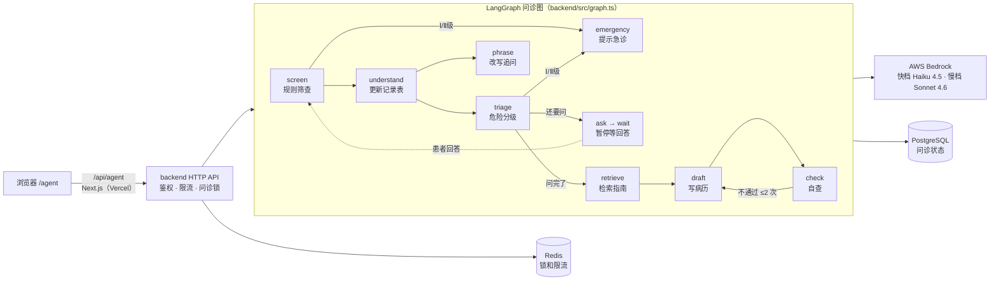
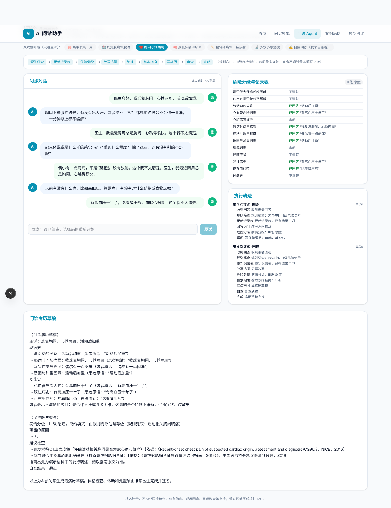

# AI 问诊助手 · 预问诊 Agent

患者见医生之前，Agent 按问诊模板追问、先用规则查危险信号，最后写一份门诊病历草稿给医生，每条给医生的建议都标注诊疗指南出处。Agent 不下诊断。

## 架构



部署形态：ECS Fargate + RDS + ElastiCache，私有子网经 VPC 终端节点访问 Bedrock（[deploy/aws/](deploy/aws/README.md)）。单机演示用 SQLite 和内存，`npm run demo` 即可。

## 关键设计决策

| 决策 | 原因 | 详见 |
|---|---|---|
| 流程由代码控制（workflow），不是 ReAct agent | 问诊步骤固定，需要模型判断的是每一步的内容，不是顺序；所有循环都有上限，最坏 20 次模型调用 | [DESIGN.md §6、§7.4](docs/agent/DESIGN.md) |
| 问什么由规划器决定，模型只改写措辞 | 选题、去重、停止条件都是确定性的，可测试 | §7.3 |
| 规则先于模型，只升不降 | Ⅰ、Ⅱ级危险信号不调用模型就提示急诊；规则处理否认（「没有胸痛」不触发） | §3.3 |
| 记录表只接受能对上患者原话的内容 | 防编造：原话必须逐字出现、不能太短、与结论相关、不是患者否认的内容 | §7.2 |
| 不下诊断，建议必须引用指南 | 给医生的可能原因和建议检查都要标注检索到的指南片段，自查拦截没有出处的建议 | [backend/README.md](backend/README.md#指南检索12) |
| checkpointer 保存状态，`interrupt()` 暂停 | 问诊可以中断后在另一个进程继续；部署时换成 PostgreSQL，实例无状态 | §8 |
| 快、慢两档模型 | 每轮追问只用快档，写病历和自查才用慢档 | §12.4 |

## 评测结果

| 评测 | 结果 | 条件 |
|---|---|---|
| 完整问诊：病历完整性 / 准确性 | **92.5 / 92.2**（满分 100），18/18 完成，约 $0.15、60 秒一次 | 真实 Bedrock，6 个病例 × 3 次，模拟患者 Nova Pro，裁判 DeepSeek V3.1 |
| 指南引用（#12） | 引用覆盖率 100%，引用准确率 85～87% | 同上 |
| 危险信号分级 | 仅模型召回 68.3%，**模型 + 规则 100%**，否认和普通主诉误判急诊 0% | 真实 Haiku 4.5，79 条用例 |
| 危险信号规则 | 召回 42/42，明确否认误报 0/28；三轮真实评测的全部患者原话都不再误触发 | 确定性（85 条用例） |
| 每轮追问延迟（#10） | 4.74s → **3.51s（-26%）**，每轮少一次调用；开场即急诊 2 次调用 → **0 次** | 真实 Bedrock |

详见 [EVAL.md 的「真实 Bedrock 评测」](docs/agent/EVAL.md#真实-bedrock-评测2026-10-19)。样本还小（6 个病例），裁判也是模型。

## 页面

| 页面 | 说明 |
|---|---|
| **`/agent`** | **预问诊 Agent**：调用 `backend/`，显示追问、危险分级、记录表、执行轨迹和病历草稿；可以让模拟患者按病例自动回答 |
| `/consultation` | 问诊模拟：手动输入医患对话，一次生成结构化病历 |
| `/cases` | 6 个多科室病例，带标准答案 |
| `/comparison` | 多模型对比，由 LLM 裁判打分 |



## 本地运行

```bash
npm ci
cp .env.example .env.local   # 填入 AI_GATEWAY_API_KEY（/consultation、/comparison 用）

# 终端 1：问诊后端（没有 Bedrock 密钥时用离线替身模型）
API_KEYS=dev-key npm run backend:server
# 终端 2：网页，/agent 通过 BACKEND_URL 调后端
BACKEND_URL=http://localhost:8787 BACKEND_API_KEY=dev-key npm run dev
```

公开部署时可以设置 `AGENT_RATE_LIMIT_PER_MINUTE`，给 `/api/agent` 和模拟患者接口按 IP 限流（默认关闭）。

只看后端：`npm run demo`，在 http://localhost:8787 打开它自带的问诊页面。

```bash
npm test             # 全部离线
npm run typecheck
npm run lint
npm run test:integration   # 需要 PostgreSQL 和 Redis，见 deploy/aws/README.md
```

## 文档

- [设计文档](docs/agent/DESIGN.md)：问诊流程、模板、记录表、分级、接口与成本控制
- [backend/README.md](backend/README.md)：接口、配置、延迟和成本、指南检索、部署、默认模型
- [评测](docs/agent/EVAL.md)、[事故复盘](docs/agent/postmortems/)
- [部署到 AWS](deploy/aws/README.md)
- [框架对比笔记](docs/agent/FRAMEWORKS.md)、[3 分钟讲解稿](docs/agent/PITCH.md)、[Roadmap](docs/agent/ROADMAP.md)

## 早期原型与框架实验

- `experiments/next-agent/`：最早的 Next.js 版问诊 Agent（Gateway 模型、鉴别诊断、无状态），已不在生产路径上，保留用来复现「agent 对比单次调用」的评测。见 [README](experiments/next-agent/README.md) 和 [ARCHITECTURE.md](docs/agent/ARCHITECTURE.md)。
- `experiments/`：LangChain、LangGraph、CrewAI 的最小 demo，以及 CrewAI 版的同任务实现。见 [experiments/README.md](experiments/README.md)。

---

本项目为技术演示，不构成医疗建议。
